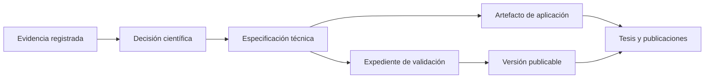

# Arquitectura documental del proyecto GOEI

| Campo | Valor |
|---|---|
| Identificador | GOEI-ARCH-001 |
| Tipo | Especificación de arquitectura documental |
| Estado | Borrador bloqueado para ratificación |
| Naturaleza | Informativa hasta aprobación de D-005 |
| Versión del documento | 0.1.0-draft |
| Decisiones de origen | D-001, D-002, D-004, D-005 y D-006 |
| Evidencia | La enlazada en los expedientes de dichas decisiones |
| Versión GOEI de incorporación | No asignada |
| Dependencias directas | Registro de decisiones; expediente D-005; expediente D-006 |
| Dependientes | Toda la estructura documental futura |

> **Límite de autoridad:** este documento traduce decisiones registradas a una arquitectura técnica. No ratifica D-005, no resuelve sus preguntas pendientes y no convierte propuestas científicas en requisitos.

## 1. Objetivo arquitectónico

Mantener el GOEI como un sistema documental:

- trazable desde cada componente hasta su decisión y evidencia de origen;
- versionable sin perder la historia ni la comparabilidad;
- modular, con separación entre norma, validación, conformidad y aplicación;
- independiente de la tecnología de cálculo;
- protegido contra la incorporación accidental de contenido no aprobado;
- capaz de producir manuales, formularios, tesis y publicaciones como vistas derivadas.

## 2. Modelo de autoridad documental

La dirección de las flechas representa dependencia y autoridad. No se permite una dependencia inversa: una tesis, formulario o implementación no puede originar silenciosamente una regla del estándar.

## 3. Vistas documentales

La arquitectura separa cuatro vistas. Su adopción definitiva depende de la ratificación de D-005.

| Vista | Contenido | Carpetas | Estado actual |
|---|---|---|---|
| Gobernanza y conocimiento | decisiones, términos, trazabilidad, fuentes, cambios | `00`, `01`, `02`, `15` | Habilitada como soporte |
| Núcleo del estándar | concepto, taxonomía, procesos, KPI, normalización, agregación, interpretación | `03` a `09` | Contenedores; contenido bloqueado según decisiones faltantes |
| Aplicación, validación y conformidad | pilotos, formularios, validación, auditoría/certificación | `10`, `11`, `14` | No definido científicamente |
| Productos derivados | tesis y publicaciones | `12`, `13` | Subordinados al estándar |

## 4. Estructura de carpetas

| Ruta | Responsabilidad única | Correspondencia D-005 | Regla de entrada |
|---|---|---|---|
| `00_Gobernanza/` | autoridad, decisiones, trazabilidad, terminología y control documental | T1/T2 | no contiene decisiones científicas nuevas fuera del registro oficial |
| `01_Estado_del_arte/` | revisiones y análisis que sustentan decisiones | base de evidencia | cada documento declara estado epistémico y fuentes |
| `02_Bibliografia/` | catálogo y copias legales de fuentes | base de evidencia | metadatos verificables; no implica aceptación científica |
| `03_Taxonomia_negocios/` | taxonomía aprobada de unidades y categorías | N2 | requiere decisión de unidad de análisis y clasificación |
| `04_Procesos_gastronomicos/` | mapa y catálogo de procesos aprobados | N3 | requiere alcance y método de descomposición aprobados |
| `05_Catalogo_KPI/` | definiciones de KPI type y matriz de admisibilidad | N4 | requiere dimensiones, criterios y KPI aprobados |
| `06_Normalizacion/` | reglas aprobadas de transformación a escala común | N5 | requiere condiciones de referencia y método aprobados |
| `07_Ponderacion_y_formula/` | ponderación, agregación, no compensación y compatibilidad | N6/N7 | requiere decisiones específicas; ningún valor puede inferirse |
| `08_Interpretacion/` | bandas, reglas de lectura y límites de uso | N8 | requiere validación y decisión de interpretación |
| `09_Manual_tecnico_general/` | especificación consolidada y manual general | N0/N1/N9 | solo integra contenido ya aprobado en fuentes anteriores |
| `10_Manual_piloto/` | protocolos y manuales por categoría para pilotos | N9 | requiere diseño piloto aprobado |
| `11_Validacion/` | protocolo, datos, análisis y expedientes de validación | T3 | criterios y compuerta pendientes de ratificación |
| `12_Tesis/` | producto académico derivado | derivado | nunca es fuente primaria de reglas GOEI |
| `13_Publicaciones/` | artículos y comunicaciones derivados | derivado | deben citar versión y alcance del estándar |
| `14_Conformidad/` | evaluación, auditoría, competencia y certificación | K1–K4 | alcance institucional pendiente de decisión |
| `15_Mantenimiento/` | versiones, cambios, compatibilidad y vigilancia | T4 | política provisional hasta gobernanza aprobada |
| `_Plantillas/` | esqueletos reutilizables no normativos | transversal | las plantillas no conceden aprobación al contenido |

## 5. Unidad documental mínima

Todo componente controlado debe contener, como mínimo:

| Campo | Propósito |
|---|---|
| Identificador persistente | localizarlo sin depender del nombre del archivo |
| Tipo documental | distinguir decisión, especificación, registro, evidencia o guía |
| Estado | impedir que un borrador se use como regla vigente |
| Naturaleza | indicar si es normativo, informativo o no determinado |
| Versión documental | controlar cambios del propio artefacto |
| Decisión de origen | demostrar autoridad científica |
| Evidencia | enlazar el respaldo aceptado por la decisión |
| Versión GOEI de incorporación | precisar vigencia dentro del estándar |
| Dependencias | declarar qué necesita para ser válido |
| Dependientes | permitir análisis de impacto |
| Responsable y aprobador | separar redacción técnica de aprobación científica |
| Historial de cambios | conservar la evolución |

Los campos vacíos se expresan como `PENDIENTE — bloquea promoción`; nunca se completan por inferencia.

## 6. Identificadores

Esquema técnico provisional:

`GOEI-{CLASE}-{NNN}`

Clases iniciales de gestión documental: `DEC` (decisión), `ARCH` (arquitectura), `REQ` (requisito), `CMP` (componente), `SRC` (fuente), `VAL` (validación), `FRM` (formulario), `CHG` (cambio) y `ISS` (pregunta/bloqueo).

Este esquema identifica artefactos, no define entidades científicas del GOEI. Los identificadores no se reutilizan después de retirar un artefacto.

## 7. Estados y compuertas

### 7.1 Estados documentales

`Borrador → En revisión técnica → En revisión científica → Aprobado → Vigente → Sustituido → Retirado`

También puede usarse `Bloqueado`, acompañado siempre por el identificador de la decisión faltante. `Aprobado` indica aceptación por la autoridad competente; `Vigente` exige además una versión GOEI de incorporación.

### 7.2 Compuerta de promoción

Un componente solo puede pasar a `Aprobado` si todos estos controles son verdaderos:

- decisión de origen existente y con estatus inequívocamente aprobado;
- evidencia enlazada desde el expediente de decisión;
- contenido técnico conforme a esa decisión, sin ampliaciones;
- impactos y dependencias revisados;
- naturaleza normativa/informativa definida por autoridad competente;
- aprobación registrada con fecha y responsable.

Solo puede pasar a `Vigente` si, además, tiene versión GOEI de incorporación y sus prerrequisitos están vigentes.

## 8. Trazabilidad

La cadena mínima es:

`Fuente → Decisión → Componente → Documento → Versión GOEI`

Para elementos medibles o reglas futuras se extiende a:

`Fuente → Decisión → Definición type → Instrumento → Dato token → Resultado → Evidencia de auditoría`

La matriz maestra está en `Matriz_de_trazabilidad.md`; el inventario de componentes está en `Registro_de_componentes.md`. Los documentos narrativos no sustituyen estos registros.

## 9. Reglas de dependencia

1. Ningún documento del núcleo puede depender normativamente de la tesis o de una publicación derivada.
2. Un manual puede depender de una especificación; una especificación no puede depender de un manual para completar un requisito.
3. Los datos piloto no se convierten en umbrales, ponderaciones o reglas sin una decisión científica explícita.
4. Una decisión sustituida conserva su identificador y enlaza a la decisión sucesora.
5. Un cambio en una decisión obliga a revisar todos los dependientes registrados antes de publicar una nueva versión.
6. Resultados producidos por versiones distintas no se declaran comparables sin un mapa de compatibilidad aprobado.

## 10. Versionado y líneas base

Se distinguen tres versiones:

- **versión documental:** evolución editorial o técnica de un archivo;
- **versión de componente:** evolución semántica del elemento controlado;
- **versión GOEI:** línea base integrada del estándar.

El detalle operativo está en `Politica_de_versionado.md`. Hasta que exista una decisión de gobernanza, toda numeración es de borrador y no representa una publicación oficial.

## 11. Arquitectura de publicación futura

Cuando las decisiones habilitantes existan, una línea base del estándar debería generarse a partir de componentes controlados y contener, sin duplicar autoridad:

1. portada, estado, alcance y versión;
2. referencias normativas;
3. términos y definiciones;
4. modelo conceptual;
5. estructura del dominio;
6. sistema de medición;
7. reglas de cálculo y decisión;
8. interpretación y límites de uso;
9. anexos de aplicación;
10. declaración de validación y trazabilidad.

La lista es una arquitectura editorial derivada de D-005, no la aceptación de contenido ni de la naturaleza normativa de cada sección.

## 12. Decisiones faltantes que bloquean la oficialización

| Bloqueo | Decisión exacta requerida | Impacto |
|---|---|---|
| GOEI-ISS-001 | Ratificar o rechazar la arquitectura por eje N0–N9, planos T1–T4 y esquema K1–K4 de D-005 | toda la estructura oficial |
| GOEI-ISS-002 | Definir si T3 es compuerta obligatoria y cuáles son sus criterios de salida | publicación de versiones |
| GOEI-ISS-003 | Definir propietario, órganos, roles y autoridad de aprobación | gobernanza y vigencia |
| GOEI-ISS-004 | Definir autoevaluación, evaluación de terceros o certificación | alcance de `14_Conformidad` |
| GOEI-ISS-005 | Aprobar la clasificación normativa/informativa por familia documental | lenguaje de requisitos |
| GOEI-ISS-006 | Ratificar CO-1 y los compromisos aplicables de D-006 | ontología y terminología |
| GOEI-ISS-007 | Fijar nombre oficial del constructo | glosario, portada y modelo conceptual |
| GOEI-ISS-008 | Fijar unidad de análisis y tratamiento de cadenas, franquicias, cocinas oscuras y multimarca | taxonomía y comparabilidad |
| GOEI-ISS-009 | Definir el tratamiento del periodo de evaluación | captura y comparabilidad temporal |
| GOEI-ISS-010 | Definir alcance global o por categoría de referencias y ponderaciones | modelo de datos y cálculo |

Hasta resolver GOEI-ISS-001, este documento constituye una propuesta técnica controlada y reversible.
