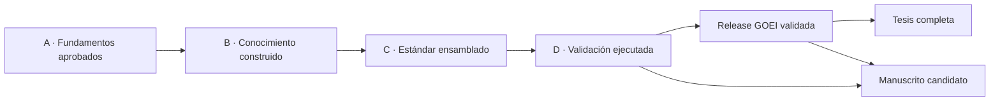

# Roadmap técnico maestro GOEI

| Campo | Valor |
|---|---|
| Identificador | GOEI-RDM-0001 |
| Versión | 1.0.0 |
| Estado | Activo |
| Responsable | Oficina Técnica GOEI |
| Fuente | Master Plan, GOEI-DIR-0001, GOEI-DIR-0002 y estado procesable |
| Naturaleza | Plan de integración; no decide ciencia ni sustituye aprobaciones |

## 1. Propósito

Ordenar el trabajo técnico desde el conocimiento aprobado hasta la release del estándar, su validación, la tesis y la publicación. El roadmap no autoriza saltar compuertas: una rama bloqueada conserva su estado mientras otras ramas técnicas independientes avanzan.

La representación canónica procesable está en `00_Gobernanza/coordinacion/technical_roadmap.json`.

## 2. Cadena de entrega

## 3. Paquetes de trabajo técnicos

| ID | Paquete | Estado | Entrada obligatoria | Producto técnico | Bloqueo vigente |
|---|---|---|---|---|---|
| WP-00 | Gobernanza y autoridad | En curso | directivas y decisiones | Constitución, RACI y registros vigentes | GOEI-ISS-001–005, 027–029 |
| WP-01 | Gestión de configuración | Completado | mandato Oficina Técnica | baselines, política de releases, manifiestos y compuertas | ninguno para operación técnica |
| WP-02 | Arquitectura del conocimiento | En curso | D-006/D-006-REV | MetaModel, Knowledge Graph, diccionarios y BOK | adopción de candidatos e Issues 031–038 |
| WP-03 | Arquitectura universal de procesos | En curso | Ontology Baseline v0.1 | MetaModelo Universal EPIC-002 | Issues 019–026 para futura oficialización |
| WP-04 | Integración de procesos científicos | Completado | D-008 + GOEI-DIR-RES-0001 | GOEI-BSL-PROC-0001 v0.1.0 y trazabilidad | GOEI-ISS-043 solo para residuos/merma |
| WP-05 | Taxonomía | Completado en núcleo | D-017 + GOEI-DIR-RES-0002 | GOEI-BSL-TAX-0001 v0.1.0 | ISS-008/054 solo para ramas concretas |
| WP-06 | KPI y admisibilidad | B3 completada; B4 habilitada | GOEI-BSL-KPI-C-0001 v0.1.0 y decisión B4 | catálogo candidato congelado y futura selección admisible | método/criterios B4 pendientes; no existen KPI aprobados |
| WP-07 | Normalización y modelo matemático | Bloqueado | B5–B8 aprobadas | especificación calculable y reproducible | ciencia no iniciada |
| WP-08 | Ensamblaje del estándar | Bloqueado | Fase B cerrada | candidato GOEI Standard | Fase B incompleta |
| WP-09 | Validación piloto | Bloqueado | candidato y protocolo aprobados | expedientes, datos y resultados validados | GOEI-ISS-041/Fase D |
| WP-10 | Release validada | Bloqueado | WP-08/WP-09 + G0–G5 | release publicada e inmutable | estándar y validación pendientes |
| WP-11 | Ensamblaje de tesis | Bloqueado | release validada y 64 requisitos satisfechos | tesis completa reproducible | GOEI-ISS-039 |
| WP-12 | Preparación de publicación | Bloqueado | contribución, resultados y autoría aprobados | manuscrito potencialmente publicable | GOEI-ISS-040 |
| WP-13 | Repositorio Open Science | En curso parcial | políticas de acceso, licencias, ética y datos | paquete reproducible | decisiones institucionales/datos pendientes |
| WP-14 | Software futuro | Bloqueado | estándar estable | implementación conforme | Fase F |

## 4. Prioridad operacional vigente

1. Mantener integridad de baselines, registros e identificadores.
2. Detectar decisiones y handoffs nuevos; integrar solo los aprobados.
3. Mantener listas las plantillas y herramientas de promoción.
4. Preservar `GOEI-BSL-PROC-0001 v0.1.0` y su exclusión controlada de residuos/merma.
5. Ejecutar B4 desde su contrato científico: decidir primero método y criterios, evaluar después los 31 candidatos congelados y excluir C-032 de la cola KPI.
6. Mantener tesis y publicaciones como ensamblajes derivados, nunca como fuentes del estándar.

## 5. Criterios de cierre de paquete

Un paquete solo puede marcarse `complete` cuando:

- todas sus dependencias están completas;
- posee evidencia canónica existente;
- no conserva blockers incompatibles con su alcance;
- su autoridad aprobadora está registrada cuando corresponda;
- los registros de componentes, trazabilidad y cambios están actualizados;
- las validaciones técnicas aplicables resultan conformes.

## 6. Ruta crítica actual

La ruta crítica científica es: **B4–B10 → candidato C → validación D → release validada → tesis/publicación**. B3 quedó resuelta en su pregunta nuclear por `GOEI-DIR-RES-0003`.

El trabajo técnico fuera de esa ruta continúa en configuración, Knowledge Graph, BOK, controles, plantillas, reproducibilidad y preparación editorial estructural.
