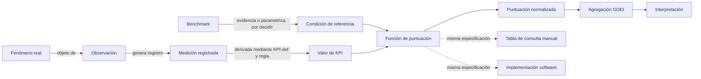

# Auditoría arquitectónica de la propuesta GTRM

| Campo | Valor |
|---|---|
| Identificador | GOEI-GTRM-AUD-ARCH-0001 |
| Tipo | Auditoría técnica y de arquitectura de conocimiento |
| Estado | Informe consultivo; sin efecto normativo |
| Objeto | Propuesta GOEI Technical Reference Matrix (GTRM) |
| Responsable | Oficina Técnica GOEI |
| Autoridad científica | Comité Científico GOEI |
| Autoridad de aprobación | Dirección General, conforme a GOEI-GOV-RACI-0001 |
| Baseline protegida | Ontology Baseline v0.1 |
| Exclusiones | Validez científica, selección de referencias, KPI, fórmulas, parámetros, umbrales, tolerancias y dictamen A/B/C |

## 1. Propósito y límites

Este informe determina qué contratos de información, trazabilidad, versión, aplicación manual y software serían necesarios **si** una decisión científica posterior aceptara alguna forma de GTRM. No incorpora la GTRM al estándar, no modifica D-006/D-006-REV, no cierra B5 o B6 y no presupone que toda referencia deba ser específica por categoría.

Las definiciones siguientes son distinciones arquitectónicas provisionales: delimitan objetos que un sistema debe poder identificar sin afirmar cómo deben construirse científicamente. Cuando contradicen o refinan la agrupación `Observación / Medición` de D-006, su incorporación exige Issue formal, decisión competente y nueva versión de la ontología.

## 2. Glosario conceptual provisional

| Concepto | Delimitación arquitectónica provisional | Entrada/salida o vínculo | Estado de autoridad |
|---|---|---|---|
| Fenómeno real | Entidad, cualidad, estado o evento del dominio que existe con independencia de su registro. | Es objeto de una observación. | Compatible con el estrato Realidad de D-006-REV. |
| Observación | Acto situado mediante el cual un agente o sistema observa un fenómeno, asociado a entidad, proceso, evento y periodo. | Genera o motiva una medición registrada. | D-006 agrupa observación/medición; separar el acto requiere decisión. |
| Medición registrada | Artefacto informacional que conserva el dato capturado, unidad, instrumento, método, agente, tiempo, procedencia y estado de calidad. No es el fenómeno ni el acto. | Representa el resultado registrado de una observación; alimenta el cálculo de KPI. | Entidad candidata; decisión requerida para incorporarla a D-006. |
| Valor de KPI | Resultado informacional derivado de mediciones registradas mediante una definición y regla de cálculo versionadas. | Entrada candidata de una función de puntuación; conserva derivación. | Compatible con la distinción KPI-def/token de D-006; contrato detallado pendiente. |
| Condición de referencia | Especificación de un estado o patrón contra el cual puede evaluarse un valor de KPI. | Puede parametrizar o restringir una función de puntuación. | Reconocida por D-004/D-006; contenido y alcance pendientes de B5. |
| Benchmark | Artefacto comparativo obtenido o declarado para una población, categoría, jurisdicción y periodo determinados, con método, fuentes y vigencia. | Puede aportar evidencia o parámetros a una condición de referencia. | Distinción candidata; relación exacta requiere decisión científica. |
| Función de puntuación | Especificación versionada de una transformación con dominio, codominio, entradas, parámetros, comportamiento frontera, precisión y errores. | Recibe el tipo de entrada que apruebe el Comité y produce una salida declarada. | B6; inexistente como contenido aprobado. |
| Normalización | Operación aprobada destinada a expresar resultados heterogéneos en una escala común. | Puede coincidir con la función de puntuación o ser posterior; la arquitectura no puede decidirlo. | B6; decisión requerida. |
| Puntuación normalizada | Registro de salida de una transformación aprobada, unido a su entrada, función, parámetros, baseline, precisión e incertidumbre. | Alimentaría agregación únicamente cuando sea válida y aprobada. | Entidad candidata dependiente de B6. |
| Tabla de consulta manual | Representación controlada y versionada de una especificación de transformación para uso en papel. | Debe ser derivada y equivalente a la misma fuente normativa que el software. | Artefacto técnico candidato; no es autoridad científica independiente. |
| Interpretación | Especificación que asigna significado permitido y límites de inferencia a una salida. | Consume resultados válidos; no altera retrospectivamente el cálculo. | B8; sin contenido aprobado. |
| GTRM | Contenedor candidato que podría reunir referencias, parámetros, transformación, representación manual y procedencia, según futura decisión. | Su frontera exacta depende de si produce parámetros o puntuación normalizada. | Hipótesis sometida a auditoría; no es componente GOEI vigente. |

### 2.1 Invariantes terminológicos candidatos

1. Una observación no es intercambiable con su medición registrada.
2. Una medición registrada no es un valor de KPI salvo que una regla aprobada declare identidad entre ambos.
3. Un benchmark no adquiere por existir el carácter de condición normativa de referencia.
4. Una tabla manual no constituye una segunda función ni una fuente normativa autónoma.
5. Una puntuación normalizada siempre referencia la versión exacta de la transformación que la produjo.
6. La interpretación no corrige, completa ni autoriza una transformación incompleta.

## 3. Flujo y procedencia



El punto de entrada de una futura GTRM queda deliberadamente sin resolver. Arquitectónicamente se recomienda que una transformación opere sobre un `Valor de KPI` calculado y trazable, no sobre observaciones heterogéneas; sin embargo, convertir esta recomendación en regla exige decisión científica. Si una GTRM produjera ya la `Puntuación normalizada`, aplicar después otra normalización sería doble transformación salvo que la decisión B6 defina funciones distintas con propósitos, dominios y codominios explícitos.

### 3.1 Procedencia mínima por resultado

Toda salida reproducible debería enlazar, como mínimo:

- evaluación, establecimiento y periodo;
- observación, medición registrada y evidencia original;
- definición y versión del KPI;
- regla de cálculo del valor KPI;
- condición de referencia y benchmark, cuando sean aplicables;
- función, parámetros, GTRM y baseline exactos;
- política de precisión y redondeo;
- implementación utilizada —tabla manual o software—;
- agente o sistema ejecutor, fecha y estado de calidad/incertidumbre.

AX-11 continúa gobernando el anclaje de la observación. Este informe no lo reemplaza ni lo amplía normativamente.

## 4. Matriz de impacto

Los estados significan: `sin cambio` conserva el contrato vigente; `ampliar` agrega documentación o implementación sin alterar ciencia aprobada; `reescribir` indica que la aceptación futura invalidaría la estructura actual; `decisión requerida` impide ejecutar el cambio hasta resolución científica o normativa.

| Componente | Estado | Impacto técnico condicionado |
|---|---|---|
| Constructo GOEI | Decisión requerida | Determinar si referencias y puntuaciones representan válidamente el constructo; Codex no puede resolverlo. |
| Ontology Baseline v0.1 | Decisión requerida | Separar observación, acto de medición y registro, o incorporar GTRM, exige Issue y nueva baseline; v0.1 permanece intacta. |
| GOEI MetaModel | Ampliar | Tras aprobación, registrar entidades/relaciones versionadas sin redefinir las clases científicas. |
| Knowledge Graph | Ampliar | Representar expediente, decisión, fuentes, versiones, sucesión, aplicabilidad e impacto; sin inferir autoridad. |
| Taxonomía | Decisión requerida | No puede suponerse que toda referencia sea específica por categoría ni utilizar taxonomía no aprobada. |
| Procesos | Sin cambio | El lenguaje EPIC-002 puede enlazar mediciones con procesos; una GTRM no redefine procesos. |
| KPI y admisibilidad | Decisión requerida | Debe resolverse si un KPI admisible puede existir sin función vigente y cuál es el tipo de entrada. |
| Especificación de medición B5 | Reescribir | Si GTRM se acepta, B5 deberá distinguir captura, registro, cálculo KPI, referencias y benchmarks. |
| Normalización B6 | Reescribir | Debe eliminarse cualquier doble transformación y fijarse frontera entre función, GTRM y normalización. |
| Modelo matemático B7–B8 | Decisión requerida | Orden de operaciones, incertidumbre, agregación e interpretación requieren contenido científico aprobado. |
| Validación B9 | Ampliar | Incluiría validación de funciones, sensibilidad, vigencia y equivalencia, con criterios aportados por el Comité. |
| Manual Técnico y BOK | Ampliar | Documentar conceptos, selección, uso, límites e historial solo tras aprobación. |
| Formularios | Ampliar | Capturar IDs/versiones, unidades, entradas, estado de cálculo y tabla aplicada. |
| Software/motor | Ampliar | Resolver componentes por claves explícitas; conservar trazas; rechazar ausencia, ambigüedad o incompatibilidad. |
| Constitución y gobernanza | Decisión requerida | Fijar autoridad de aprobación, suspensión, sustitución y precedencia de referencias. |
| Arquitectura documental/repositorio | Ampliar | Crear familia, esquemas, fixtures, manifiestos y baselines únicamente después de decisión formal. |
| Tesis y publicaciones | Ampliar | Podrán describir auditoría y decisión con su estado; no presentar GTRM como resultado aprobado antes de tiempo. |

## 5. Identidad y ciclo de vida candidatos

### 5.1 Contrato mínimo de identidad

Una eventual instancia GTRM debería declarar, sin campos implícitos:

| Grupo | Campos candidatos |
|---|---|
| Identidad | ID inmutable, nombre, versión, revisión, estado y baseline contenedora. |
| Alcance | KPI-def y versión, proceso, categoría/población, jurisdicción, unidad, periodo, dominio de validez y exclusiones. |
| Entradas | Tipo admitido, unidad, calidad mínima, tratamiento de ausencia y precondiciones. |
| Referencias | IDs/versiones de condición de referencia y benchmark; fuentes y método declarados. |
| Transformación | ID/versión de función, conjunto de parámetros, dominio, codominio y orden de operaciones. |
| Salida | Tipo, escala, precisión, redondeo, estado de cálculo y representación de incertidumbre. |
| Autoridad | Decisión científica de origen, aprobación normativa, responsable de revisión y fechas de vigencia. |
| Implementaciones | Tabla manual, implementación software y conjunto canónico de pruebas, todos con checksum. |
| Historia | Predecesora/sucesora, motivo del cambio, compatibilidad y política de migración. |

Ningún campo de metadatos sustituye la decisión científica. Una instancia completa en forma, pero sin decisión de origen, permanece `propuesta` y no puede puntuar evaluaciones oficiales.

### 5.2 Estados candidatos

```text
borrador → revisión científica → recomendada → aprobada → vigente
                                           ↘ devuelta | rechazada
vigente → suspendida → vigente
vigente → sustituida → retirada
```

- `aprobada` no equivale a `vigente`: requiere baseline y fecha de efecto.
- `suspendida`, `sustituida` y `retirada` no permiten nuevas evaluaciones, salvo decisión de transición explícita.
- una corrección que pueda alterar una salida crea una versión nueva; nunca sobrescribe la anterior.
- la decisión competente deberá fijar qué cambios son mayores, menores o meramente editoriales.

## 6. Aplicabilidad y precedencia

La resolución técnica de una GTRM debe usar coincidencias explícitas, no inferencia heurística. Claves candidatas: `KPI + versión`, `unidad`, `jurisdicción`, `categoría/población`, `periodo/vigencia` y `dominio`.

Pueden registrarse como candidatos cuatro alcances de referencia —universal, regulatorio/seguridad, jurisdiccional y específico de categoría/población—, pero este informe no determina que todos existan ni su precedencia. Esa precedencia y cualquier regla de mayor exigencia corresponden al Comité y a una aprobación formal.

Resultado técnico de selección:

| Situación | Comportamiento requerido |
|---|---|
| Una coincidencia vigente y compatible | Seleccionable, conservando ID y versión. |
| Ninguna coincidencia | `no_calculable`; abrir/enlazar Issue; no usar valor por defecto. |
| Más de una coincidencia sin precedencia aprobada | `conflicto_de_referencia`; bloquear solo ese cálculo. |
| Unidad incompatible sin conversión aprobada | `entrada_incompatible`. |
| GTRM suspendida, retirada o fuera de vigencia | No usar en evaluaciones nuevas. |
| Evaluación histórica | Usar la versión originalmente fijada, aunque hoy esté sustituida. |

El software no puede interpretar que una referencia universal prevalece sobre una jurisdiccional, ni que una categoría vecina es equivalente. Toda selección debe ser explicable y reconstruible.

## 7. Reproducibilidad histórica

1. Las versiones publicadas son inmutables y direccionables por ID más versión.
2. Cada evaluación congela un manifiesto con todas las definiciones, referencias, parámetros, tablas y código utilizados.
3. Fuentes, tablas y artefactos conservan checksums y fechas de acceso/vigencia.
4. Una evaluación cerrada no se recalcula silenciosamente al actualizar una GTRM.
5. El recálculo histórico se ejecuta con la baseline original y produce una revisión enlazada, nunca un reemplazo.
6. Una simulación con versión nueva se identifica como contrafactual y no modifica el resultado oficial histórico.
7. Todo cambio documenta impacto, compatibilidad, resultados potencialmente afectados y razón de sustitución.
8. Los artefactos retirados permanecen disponibles para auditoría conforme a políticas de acceso y retención.

## 8. Equivalencia entre papel y software

La fuente normativa debe ser una especificación neutral. La tabla manual y el ejecutable son representaciones derivadas de esa misma fuente y deben declarar su versión y checksum.

El conjunto canónico de conformidad incluirá, cuando la ciencia aporte los resultados esperados:

- límites exactos y valores inmediatamente adyacentes;
- extremos dentro y fuera del dominio;
- datos faltantes, inválidos y no aplicables;
- conversiones de unidad aprobadas;
- precisión y redondeo;
- referencias ausentes, múltiples o incompatibles;
- versiones suspendidas, expiradas, sustituidas e históricas;
- representación de incertidumbre y estados de suficiencia.

Cada caso contendrá entrada, contexto, versión, pasos manuales, salida esperada y tolerancia aprobada. Codex implementará y verificará la tolerancia, pero no la elegirá. Una divergencia produce fallo de conformidad, bloquea la promoción de la representación afectada y abre Issue; el software nunca prevalece automáticamente sobre el papel ni a la inversa.

## 9. Incertidumbre: requisitos de representación

Sin seleccionar método científico, la arquitectura debe poder conservar por separado:

- incertidumbre o calidad de la medición registrada;
- incertidumbre muestral o del benchmark;
- incertidumbre de parámetros o de la función;
- incertidumbre de la puntuación resultante;
- método, nivel o clase de confianza, supuestos, unidad y procedencia;
- estado de suficiencia para calcular o interpretar.

Intervalos, clases de confianza, reglas de redondeo y estados de suficiencia son mecanismos posibles, no adoptados. El Comité debe decidir cuáles aplican y cuándo impiden el cálculo o la interpretación.

## 10. Riesgos técnicos y controles candidatos

| Riesgo | Impacto | Control arquitectónico candidato |
|---|---|---|
| Doble normalización | Resultados deformados o escala opaca | Declarar dominio/codominio y una sola responsabilidad por transformación. |
| Confusión observación–medición–KPI | Pérdida de auditabilidad | IDs y relaciones de derivación separados. |
| Referencia implícita | Selección no reproducible | Resolver solo por claves y precedencia aprobadas. |
| Proliferación combinatoria | Catálogo inmantenible | Componentes reutilizables, perfiles de aplicabilidad y detección de duplicados; sin fusionar ciencia distinta. |
| Deriva temporal | Comparaciones históricas inválidas | Vigencia, baselines inmutables y mapas de compatibilidad. |
| Divergencia papel–software | Dos estándares de facto | Especificación única y pruebas canónicas bidireccionales. |
| Falsa precisión | Confianza indebida | Política explícita de precisión, incertidumbre y límites de interpretación. |
| Gaming o discontinuidades | Conducta oportunista alrededor de cortes | Casos frontera, monitoreo y revisión científica; Codex solo instrumenta. |
| Parámetros huérfanos | Resultados sin justificación | Cada parámetro enlazado a evidencia, decisión y versión. |
| Cambio retroactivo silencioso | Ruptura de auditoría | Prohibición de sobrescritura y recálculo versionado. |
| Autoridad ambigua | Artefactos técnicos tratados como ciencia | Decisión científica y aprobación normativa obligatorias y diferenciadas. |
| Implementación no determinista | Resultados distintos con mismas entradas | Manifiesto, precisión, orden de operaciones y pruebas reproducibles. |

## 11. Alternativas de ubicación en el pipeline

| Alternativa | Diseño | Ventaja técnica | Riesgo/condición |
|---|---|---|---|
| 1. Integrada en B5/B6 | B5 aprueba medición y referencias; B6 aprueba función/normalización y sus representaciones. | Menor cambio al pipeline vigente. | Requiere fronteras rigurosas para que GTRM no duplique ambas fases. |
| 2. Nueva subfase entre B5 y B6 | B5 medición; B5R referencias/benchmarks; B5P función/GTRM; B6 valida escala común. | Máxima visibilidad de autoridad y dependencias. | Mayor gobernanza; solo válida si GTRM tiene identidad científica independiente. |
| 3. Familia transversal B5–B8 | GTRM es un paquete versionado que referencia decisiones de medición, referencia, función, normalización e interpretación. | Evita convertir un contenedor en nueva etapa científica. | Necesita controlar versiones parciales y prohibir paquetes híbridos incoherentes. |

La Oficina Técnica recomienda **no seleccionar todavía** una alternativa. La decisión depende de la respuesta científica a dos preguntas: (a) si la GTRM produce parámetros o una puntuación ya normalizada; y (b) si posee identidad científica independiente o es una representación empaquetada de decisiones B5–B8.

## 12. Decisiones e Issues requeridos antes de integrar

1. Tipo exacto de entrada de la GTRM: observación, medición registrada o valor KPI.
2. Tipo exacto de salida: parámetros, puntuación previa o puntuación normalizada.
3. Identidad o diferencia entre función de puntuación y normalización.
4. Relación formal entre condición de referencia y benchmark.
5. Alcances permitidos y precedencia entre referencias.
6. Representación y efecto de la incertidumbre.
7. Autoridad científica de la transformación y autoridad de vigencia normativa.
8. Reglas de aprobación, suspensión, sustitución y retiro.
9. Admisibilidad de un KPI sin función vigente.
10. Tolerancia de equivalencia papel–software.
11. Issue formal para cualquier cambio propuesto a D-006/D-006-REV.
12. Decisión de ubicación en B5–B8 después del dictamen científico.

Hasta resolverlas, la GTRM permanece como hipótesis auditada y toda rama que dependa de ella queda bloqueada selectivamente. El resto del pipeline GOEI conserva sus compuertas vigentes.

## 13. Fuentes internas de autoridad utilizadas

- D-004, D-006 y D-006-REV, según `00_Gobernanza/Registro_de_decisiones.md`.
- Ontology Baseline v0.1 y política Issue-only, según `00_Gobernanza/Matriz_de_trazabilidad.md`.
- `09_Manual_tecnico_general/Revision_tecnica_arquitectonica_D006.md`.
- `00_Gobernanza/coordinacion/PIPELINE_B2_B10.md`.
- `00_Gobernanza/Matriz_de_autoridad_institucional.md`.
- EPIC-001 GOEI MetaModel, reglas de integridad y restricciones de consistencia.

Este inventario acredita la procedencia arquitectónica del informe; no constituye evidencia científica de aceptación de GTRM.
