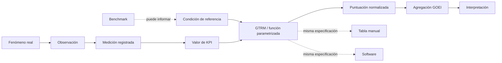

# Auditoría metodológica consolidada de la propuesta GTRM

| Campo | Valor |
|---|---|
| Identificador | GOEI-GTRM-AUD-0001 |
| Fecha | 2026-08-04 |
| Estado | Dictamen consultivo; pendiente de resolución formal |
| Dictamen | **B — Aceptar con modificaciones** |
| Autoridad científica | Comité Científico GOEI (Claude) |
| Autoridad técnica | Oficina Técnica GOEI (Codex) |
| Fuente auditada | `GTRM_PROPUESTA_FUENTE_NO_NORMATIVA.txt` |
| Huella SHA-256 de fuente | `6462dbe1d827cef5abd91ad020a1f9ae7d791930aa66bbeb6a40eeee7562f6d2` |
| Efecto normativo | Ninguno hasta decisión competente |
| Baseline protegida | D-006 Ontology Baseline v0.1, sin modificación |

## 1. Dictamen ejecutivo

La propuesta responde a un problema metodológico real: el GOEI no puede aceptar una puntuación cuya transformación carezca de evidencia, procedencia, autoridad y versión. Sin embargo, una GTRM no constituye una nueva ciencia de puntuación ni una fase autónoma. Debe reencuadrarse como **artefacto normativo versionado que contiene o referencia la condición de referencia, la función de puntuación, sus parámetros, evidencia, incertidumbre y dominio de validez para ejecutar una única normalización**.

La aceptación se condiciona a seis correcciones inseparables:

1. eliminar la doble normalización;
2. distinguir condición de referencia de benchmark;
3. tratar la función como fuente lógica y la tabla manual/software como representaciones derivadas;
4. asignar identidad, procedencia, autoridad y ciclo de vida;
5. representar incertidumbre y preservar versiones históricas;
6. definir ausencia, conflicto, aplicabilidad y equivalencia papel–software.

No se incorpora GTRM al estándar mediante esta auditoría. Se requiere una decisión formal posterior y un Issue antes de modificar D-006.

## 2. Cadena conceptual controlada

| Concepto | Delimitación resultante |
|---|---|
| Observación | Acto situado de observar un fenómeno, anclado conforme AX-11. |
| Medición registrada | Registro persistente del dato capturado, unidad, método, instrumento, agente, periodo y calidad. |
| Valor de KPI | Resultado derivado de una o más mediciones mediante una definición y regla de cálculo versionadas. |
| Condición de referencia | Estado prescriptivo contra el cual se evalúa el valor KPI. |
| Benchmark | Valor o distribución descriptiva de una población, categoría, jurisdicción y periodo. Puede informar una referencia, pero no la sustituye automáticamente. |
| Función de puntuación | Transformación versionada con dominio, codominio, parámetros, comportamiento frontera, precisión y restricciones. |
| Normalización | Aplicación única de la función aprobada para expresar el KPI en la escala común. |
| Puntuación normalizada | Salida trazable de esa transformación, asociada a función, parámetros, referencia, versión e incertidumbre. |
| Tabla manual | Representación discretizada y controlada de la misma especificación usada por el software. |
| Interpretación | Significado permitido de la salida y límites de inferencia; no modifica el cálculo. |

Flujo admitido para futura decisión:



## 3. Respuestas decisivas

| Pregunta | Respuesta consultiva |
|---|---|
| ¿Sobre qué actúa? | Sobre el valor de KPI derivado de mediciones registradas; no sobre la observación cruda. |
| ¿Qué produce? | Porta parámetros justificados y, al aplicarse una vez, produce la puntuación normalizada del KPI; no el resultado GOEI. |
| ¿Existe doble normalización? | Sí en el flujo original. GTRM y motor de normalización deben constituir un único paso lógico. |
| ¿Función, parametrización o tabla? | Función de valor parametrizada y gobernada; la tabla es una representación manual derivada. |
| ¿Referencia equivale a benchmark? | No. La primera es prescriptiva; el segundo es descriptivo. |
| ¿Toda referencia es por categoría? | No se demostró. Pueden existir dominios universales, regulatorios, jurisdiccionales, sectoriales o categoriales. |
| ¿Quién selecciona la precedencia? | Una decisión científica y normativa explícita; nunca la taxonomía o el software por inferencia. |
| ¿Dónde reside la autoridad científica? | En la evidencia y método aprobados que justifican referencia, función y parámetros. La vigencia normativa corresponde al órgano competente. |
| ¿Qué ocurre sin referencia? | No se calcula ni se crea fallback; se bloquea solo ese KPI×dominio y se abre/enlaza Issue. |
| ¿Puede existir KPI sin GTRM? | Puede existir como definición o candidato, pero no ser puntuable ni agregable hasta disponer de transformación vigente, si esta regla se aprueba. |

## 4. Clasificación multidimensional candidata

No se adopta una lista plana porque mezcla autoridad, método y alcance. Una eventual GTRM se clasificaría simultáneamente por ejes ortogonales:

| Eje | Valores candidatos no normativos |
|---|---|
| Autoridad/efecto | regulatoria; normativa GOEI; informativa |
| Origen de evidencia | norma; empírica; estadística; consenso experto/Delphi; híbrida |
| Alcance | universal; internacional; jurisdiccional; sectorial; categoría/población |
| Función | referencia crítica/no compensable; puntuación gradual; benchmark informativo |
| Madurez | borrador; en revisión; recomendada; aprobada; vigente; suspendida; sustituida; retirada |

Los valores y precedencias definitivos corresponden a una decisión posterior. La regla propuesta por el Comité de preferir autoridad legal y mayor exigencia se conserva como **candidata**, no como regla GOEI vigente.

## 5. Impacto consolidado

| Componente | Impacto si se ratifica B |
|---|---|
| Constructo | Sin cambio directo; debe demostrarse que las transformaciones representan el constructo. |
| Ontología | Decisión requerida: separar observación/medición registrada y añadir el artefacto GTRM mediante Issue y nueva baseline. |
| Taxonomía | Ampliar como entrada de aplicabilidad, sin asumir que toda referencia es categorial. |
| Procesos | Sin cambio estructural; conservar relación de medición con proceso. |
| KPI/admisibilidad | Ampliar estados para separar definido, admisible, puntuable e integrable. |
| B5 medición | Reescribir para separar captura, registro, valor KPI, referencia y benchmark. |
| B6 normalización | Reescribir para una sola función, con GTRM como especificación/parametrización gobernada. |
| Ponderación/agregación | Sin cambio de contenido; consumir solo puntuaciones normalizadas válidas. |
| Interpretación | Ampliar límites de inferencia y efecto de incertidumbre/versiones. |
| Validación | Ampliar a función, parámetros, sensibilidad, incertidumbre y equivalencia. |
| Manual/formularios | Ampliar IDs/versiones, dominio, tabla aplicada, incertidumbre y estados no calculables. |
| Software | Ampliar selección explícita, manifiestos, errores, historial y pruebas de conformidad. |
| Knowledge Graph/MetaModel | Ampliar solo después de decisión; representar procedencia, aplicabilidad, sucesión y autoridad. |
| Constitución/BOK | Decisión requerida para autoridad; ampliar documentación después de ratificación. |
| Repositorio | Crear familia, esquema y baseline solo después de adopción oficial. |
| Tesis/publicaciones | Describir auditoría como resultado consultivo; no presentar GTRM como estándar vigente. |

## 6. Identidad, autoridad y ciclo de vida candidatos

Una GTRM futura requeriría como mínimo:

- ID inmutable, versión, revisión, estado, vigencia y baseline;
- KPI y versión, proceso, unidad y tipo exacto de entrada;
- categoría/población, jurisdicción, periodo y dominio;
- condición de referencia y benchmark diferenciados;
- función, parámetros, dominio, codominio, precisión y redondeo;
- evidencia, método, incertidumbre y limitaciones;
- decisión científica de origen y aprobación normativa;
- tabla manual, implementación software y casos canónicos con checksum;
- predecesora, sucesora, compatibilidad y motivo de cambio.

Ciclo candidato:

```text
borrador → revisión científica → recomendada → aprobada → vigente
                                           ↘ devuelta | rechazada
vigente → suspendida → vigente
vigente → sustituida → retirada
```

Ninguna versión se sobrescribe. Una evaluación histórica conserva la versión original; una simulación con versión nueva se marca como contrafactual.

## 7. Incertidumbre y equivalencia

La arquitectura debe representar separadamente incertidumbre de:

- medición;
- muestreo;
- benchmark;
- parámetros;
- puntuación propagada.

El método, intervalo, clase de confianza, tolerancia o regla de suficiencia no se fija aquí. Debe decidirlo el Comité para cada familia aplicable.

La equivalencia papel–software se verificará con casos canónicos de límites, adyacencias, extremos, faltantes, unidades, redondeos, conflictos, vigencias e incertidumbre. Tabla y software deben derivar de una misma especificación. La tolerancia requiere aprobación científica; una divergencia bloquea la representación afectada.

## 8. Pipeline recomendado

No se crea una fase autónoma. Se recomienda mantener el orden y hacer explícito el sustrato GTRM:

```text
B5 Especificación de medición
→ referencia/benchmark aplicable
→ GTRM: función y parámetros justificados
→ B6 aplicación única de normalización
→ B7 ponderación y agregación
→ B8 interpretación
→ B9 validación integral
```

Las GTRM reales dependen como mínimo de B2, B4 y B5. El pipeline oficial no cambia hasta ratificación.

## 9. Riesgos críticos

| Riesgo | Consecuencia | Tratamiento requerido |
|---|---|---|
| Doble normalización | Distorsión y opacidad | Una función y un dominio/codominio explícitos |
| Referencia confundida con benchmark | Descriptivo tratado como normativo | Entidades y autoridad separadas |
| Tabla sin función | Arbitrariedad documentada, no resuelta | Publicar especificación generadora |
| Falsa precisión | Confianza injustificada | Incertidumbre y suficiencia explícitas |
| Discontinuidades | Gaming en puntos de corte | Validación de fronteras y sensibilidad |
| Explosión combinatoria | Sistema inmantenible | Estudio de gobernanza y reutilización controlada |
| Deriva temporal | Comparabilidad histórica rota | Baselines inmutables y mapas de compatibilidad |
| Jurisdicciones múltiples | Fragmentación internacional | Dominios y precedencia aprobados |
| Autoridad ambigua | Artefacto técnico tratado como ciencia | Decisión científica y aprobación normativa diferenciadas |

## 10. Condiciones para futura incorporación

1. ratificar, devolver o rechazar este dictamen B;
2. abrir Issue de cambio contra D-006 antes de proponer nueva baseline;
3. cerrar B2, B4 y B5 para producir instancias reales;
4. resolver identidad entre función de puntuación y normalización;
5. aprobar política de referencias y precedencia;
6. aprobar política de incertidumbre;
7. aprobar autoridad y ciclo de vida;
8. aprobar protocolo y tolerancia papel–software;
9. estudiar proliferación combinatoria y compatibilidad;
10. emitir una decisión científica específica antes de modificar pipeline, BOK, tesis o software.

## 11. Fuentes del expediente

- `GOEI_GTRM_DICTAMEN_CIENTIFICO.md`: evidencia, análisis metodológico y dictamen B.
- `GOEI_GTRM_AUDITORIA_ARQUITECTONICA.md`: impacto, identidad, ciclo, reproducibilidad y software.
- `GOEI_GTRM_MATRIZ_DE_PREGUNTAS_Y_CONTROLES.md`: cobertura y gate de integridad.
- `GTRM_PROPUESTA_FUENTE_NO_NORMATIVA.txt`: propuesta original preservada con huella.

Este documento consolida resultados sin convertirlos en decisión oficial, baseline ni contenido normativo del GOEI.
