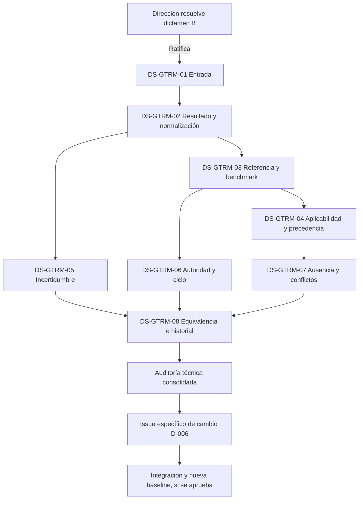

# Expediente formal para la resolución de GOEI-ISS-044

| Campo | Valor |
|---|---|
| Identificador | GOEI-EXP-ISS-044-0001 |
| Versión documental | 1.0.0 |
| Fecha de preparación | 2026-08-04 |
| Estado | Resuelto por GOEI-DIR-RES-GTRM-0001; Opción A |
| Issue de origen | GOEI-ISS-044 |
| Dictamen sometido | GOEI-GTRM-AUD-0001 — B: aceptar con modificaciones |
| Autoridad científica del dictamen | Comité Científico GOEI |
| Preparó | Oficina Técnica GOEI |
| Autoridad de resolución inicial | Dirección General GOEI |
| Baseline protegida | D-006 Ontology Baseline v0.1 |
| Efecto actual sobre el estándar | Ninguno; habilita únicamente DS-GTRM-01–08 |

> Este expediente organiza decisiones pendientes. No selecciona alternativas, no aprueba la GTRM, no modifica D-006, no cambia B5/B6 y no autoriza instancias, fórmulas, parámetros, umbrales ni tolerancias.

## 1. Objeto

Permitir que la Dirección General resuelva el destino del dictamen consultivo B y, si lo ratifica, encargue al Comité Científico decisiones separadas, trazables y no sustituibles entre sí sobre la arquitectura metodológica GTRM.

La resolución debe preservar esta secuencia:

```text
Resolución directiva sobre el dictamen B
→ mandato científico explícito por materia
→ expedientes y decisiones del Comité
→ auditoría técnica de suficiencia y consistencia
→ Issue de cambio específico contra D-006, cuando corresponda
→ integración técnica controlada
→ pruebas, baseline y release mediante expedientes propios
```

La ratificación del dictamen B no equivale a aprobar ninguna solución científica contenida como candidata en la auditoría.

## 2. Antecedentes controlados

1. La propuesta original se preserva como `GTRM_PROPUESTA_FUENTE_NO_NORMATIVA.txt`, SHA-256 `6462dbe1d827cef5abd91ad020a1f9ae7d791930aa66bbeb6a40eeee7562f6d2`.
2. El Comité Científico emitió `GOEI_GTRM_DICTAMEN_CIENTIFICO.md` con dictamen B.
3. La Oficina Técnica emitió `GOEI_GTRM_AUDITORIA_ARQUITECTONICA.md` y la matriz de controles.
4. `GOEI_GTRM_AUDITORIA_CONSOLIDADA.md` integró ambos análisis como `GOEI-GTRM-AUD-0001`.
5. La auditoría no tiene efectos normativos y abrió `GOEI-ISS-044`.
6. D-006 permanece congelada como Ontology Baseline v0.1; cualquier modificación requiere Issue formal, decisión competente, nueva versión y trazabilidad de impacto.
7. D-008/B1 y B2 conservan sus compuertas y no son resueltos por este expediente.

## 3. Alcance y exclusiones

### Incluye

- destino formal del dictamen B;
- separación de materias científicas pendientes;
- alternativas ya registradas en la auditoría;
- dependencias, efectos y criterios de suficiencia formal;
- mandato y orden de ejecución condicionados;
- reglas para impedir integración o versionado prematuros.

### Excluye

- definir KPI, fórmulas, parámetros, escalas, ponderaciones o umbrales;
- decidir cuál referencia prevalece;
- fijar métodos, intervalos o tolerancias de incertidumbre;
- aprobar una taxonomía o una GTRM concreta;
- modificar la ontología o cualquier baseline;
- declarar una versión del estándar o habilitar una release.

## 4. Primera compuerta: destino del dictamen consultivo

La Dirección deberá seleccionar exactamente una opción:

### Opción A — Ratificar el dictamen B y ordenar expedientes científicos separados

- [ ] SELECCIONADA

Efecto: se acepta que la propuesta resuelve un problema real pero requiere las modificaciones identificadas. No se aprueba todavía una GTRM ni una arquitectura normativa. Se habilita al Comité para resolver las materias DS-GTRM-01 a DS-GTRM-08.

### Opción B — Devolver el dictamen para subsanación

- [ ] SELECCIONADA

Efecto: `GOEI-ISS-044` permanece abierto; deberán indicarse vacíos o inconsistencias concretos. No se habilita integración ni cambio ontológico.

**Subsanación requerida:** ________________________________________________

### Opción C — Rechazar la incorporación de GTRM

- [ ] SELECCIONADA

Efecto: se cierra la vía de incorporación basada en este expediente, se conserva todo el historial y cualquier propuesta futura requerirá un nuevo Issue y expediente.

**Fundamento del rechazo:** _______________________________________________

## 5. Decisiones científicas separadas requeridas si se selecciona A

Los identificadores siguientes son **slots de expediente**, no decisiones aprobadas. Cada uno deberá recibir un ID oficial de decisión al resolverse.

| Slot | Materia indelegable | Pregunta de resolución | Alternativas presentes en la auditoría | Efecto principal | Dependencias mínimas |
|---|---|---|---|---|---|
| DS-GTRM-01 | Naturaleza y entrada | ¿La GTRM actúa sobre observación, medición registrada o valor KPI? | Observación; medición registrada; valor KPI derivado | Cadena de procedencia, B5, formularios y software | Definiciones de observación, medición y KPI |
| DS-GTRM-02 | Resultado y normalización | ¿La GTRM es función normativa, parametrización o tabla; y produce parámetros o puntuación normalizada? | Función; parametrización; tabla manual; salida paramétrica; salida normalizada | Evitar o admitir doble transformación; diseño B6 | DS-GTRM-01 y alcance de B6 |
| DS-GTRM-03 | Referencia y benchmark | ¿Son entidades diferentes y qué función cumple cada una? | Separadas; equivalentes; benchmark informativo; benchmark que fundamenta referencia | Ontología, evidencia y selección | B2, B4, B5 para instancias reales |
| DS-GTRM-04 | Aplicabilidad y precedencia | ¿Qué dominios de referencia pueden coexistir y cómo se elige entre ellos? | Universal/internacional; regulatoria; jurisdiccional; sectorial; categoría/población; combinaciones controladas | Regla de selección, conflictos y estado no calculable | DS-GTRM-03; B2 para dominios categoriales |
| DS-GTRM-05 | Incertidumbre | ¿Qué fuentes se representan y mediante qué método o estado de suficiencia? | Metadatos; intervalos; clases de confianza; redondeo; estados de suficiencia; combinación aprobada | Puntuación, validación, interpretación y comparabilidad | B5, DS-GTRM-02 y método científico aplicable |
| DS-GTRM-06 | Autoridad y ciclo de vida | ¿Quién crea, aprueba, revisa, suspende y reemplaza una GTRM y dónde reside su autoridad científica y normativa? | Comité/autoridad normativa según acto; estados candidatos del ciclo auditado | Gobernanza, vigencia, sucesión y auditoría | Constitución y gobernanza vigentes |
| DS-GTRM-07 | Ausencia, conflicto y puntuabilidad | ¿Qué ocurre sin referencia válida, ante conflicto o con KPI sin función aprobada? | No calculable; Issue; suspensión de rama; KPI definible pero no puntuable/agregable | Integridad del cálculo y bloqueo selectivo | DS-GTRM-02 a 06 |
| DS-GTRM-08 | Equivalencia y reproducibilidad | ¿Qué especificación es fuente de verdad, qué casos canónicos se exigen y qué tolerancia rige? | Función/especificación común; tabla manual; software; tolerancia científicamente aprobada | Papel–software, historial, pruebas y auditoría | DS-GTRM-02, 05, 06 y 07 |

La tabla enumera alternativas para garantizar que el Comité las examine; no expresa preferencia normativa. Cuando la auditoría contiene una recomendación, esta conserva carácter consultivo y debe citarse como tal.

## 6. Criterios de resolución por slot

Cada expediente científico será formalmente suficiente solo si contiene:

1. identificador y versión inmutables;
2. pregunta exacta y alcance;
3. definiciones utilizadas y relación con D-006 v0.1;
4. alternativas consideradas, incluida la opción de no incorporar;
5. evidencia identificable y procedencia de cada afirmación;
6. decisión inequívoca y autoridad científica;
7. justificación separada de la evidencia;
8. limitaciones, incertidumbre y supuestos;
9. dependencias previas y componentes afectados;
10. consecuencias sobre aplicación manual y software;
11. compatibilidad histórica y migración prevista;
12. preguntas que permanecen abiertas;
13. recomendación expresa de incorporar, devolver o rechazar;
14. aprobación verificable del Comité;
15. versión objetivo propuesta, sin crearla por el solo hecho de proponerla.

La Oficina Técnica comprobará presencia, coherencia, trazabilidad y efectos. No evaluará ni completará el mérito científico.

## 7. Dependencias y orden de resolución



- DS-GTRM-01 y 02 son fundacionales.
- DS-GTRM-03 y 04 gobiernan las referencias; no deben inferirse desde taxonomía o software.
- DS-GTRM-05 puede diseñarse en abstracto, pero su método concreto depende de evidencia científica y B5.
- DS-GTRM-06 puede resolverse como gobernanza general antes de crear instancias.
- DS-GTRM-07 depende de la semántica de las anteriores.
- DS-GTRM-08 cierra la especificación de conformidad; la tolerancia no puede fijarla Codex.
- Las instancias reales dependen, como mínimo, del cierre competente de B2, B4 y B5.

## 8. Matriz de efectos condicionados

| Componente | Ratificar B | Aprobar slots científicos | Integración técnica posterior |
|---|---|---|---|
| D-006 Ontology Baseline v0.1 | Sin cambio | Sin cambio automático | Solo mediante Issue específico y nueva versión |
| B5 Medición | Sin cambio | Requisitos aprobados como decisiones | Modificación versionada mediante expediente propio |
| B6 Normalización | Sin cambio | Define arquitectura metodológica | Implementación después de auditoría |
| B2/B4 | Sin cambio | Conservan sus compuertas | Proveen dominios/admisibilidad cuando estén cerradas |
| Knowledge Graph/MetaModel | Registra expediente consultivo | Registra decisiones y dependencias | Incorpora nuevas entidades/relaciones aprobadas |
| Formularios/manual | Sin cambio | Obtienen requisitos | Se generan representaciones controladas |
| Software | Sin cambio | Obtiene contrato científico | Se implementa y prueba después de especificación |
| Tesis/publicaciones | Reportan auditoría consultiva | Reportan decisiones con su estado | Solo describen estándar vigente tras release |

## 9. Reglas de bloqueo e integridad

1. No se creará una entidad normativa GTRM por ratificar el dictamen B.
2. No se modificará D-006 hasta existir un Issue de cambio específico, decisión científica suficiente, análisis de impacto, versión objetivo y aprobación competente.
3. No se elegirán referencias por fallback, cercanía taxonómica o inferencia del software.
4. No se declarará puntuable o agregable un KPI si la regla científica aplicable no está aprobada.
5. No se sobrescribirán versiones ni evaluaciones históricas.
6. Tabla manual y software no podrán convertirse en fuentes normativas independientes.
7. Toda falta científica bloqueará solo el slot o dominio afectado.
8. La resolución de este expediente no altera las compuertas de D-008/B1, B2, B4 o B5.
9. Ningún artefacto técnico suplirá firma, aprobación o evidencia científica.
10. La integración normativa requerirá una nueva auditoría de consistencia conjunta de los ocho slots.

## 10. Criterios para cerrar GOEI-ISS-044

`GOEI-ISS-044` podrá cerrarse únicamente cuando exista una resolución directiva firmada que:

- seleccione exactamente A, B o C;
- identifique autoridad y fecha efectiva;
- declare el efecto normativo, si alguno;
- disponga el destino del expediente;
- si selecciona A, abra y asigne formalmente DS-GTRM-01 a 08 sin prejuzgar su resultado;
- si selecciona B, enumere subsanaciones verificables;
- si selecciona C, documente fundamento y regla para propuestas futuras;
- confirme expresamente que D-006 v0.1 permanece intacta.

Si se elige A, el cierre de `GOEI-ISS-044` solo cierra la decisión sobre el **destino del dictamen**. Los slots científicos y cualquier Issue específico de cambio ontológico permanecerán abiertos hasta sus propias resoluciones.

## 11. Resultado técnico esperado según opción

| Opción | Salida inmediata | Rama habilitada | Rama bloqueada |
|---|---|---|---|
| A | Resolución registrada y ocho slots asignados | Investigación/decisión científica por slot | Integración, baseline, instancias y software normativo |
| B | Paquete de subsanación | Corrección del dictamen | Slots, integración y cambio ontológico |
| C | Resolución de rechazo e historial preservado | Trabajo técnico independiente | Incorporación GTRM basada en este expediente |

## 12. Documentos del paquete

- `GOEI_EXP_ISS_044_RESOLUCION_GTRM.md`: expediente técnico y matriz de decisiones.
- `GOEI_DIR_RES_ISS_044_GTRM_BORRADOR.md`: plantilla de resolución directiva.
- `GOEI_CC_DEC_GTRM_SLOT_PLANTILLA.md`: plantilla científica reutilizable para cada slot.
- Auditoría científica, arquitectónica, consolidada y matriz de controles ubicadas en `coordinacion/auditorias/GTRM/`.

---

**Estado de control:** resuelto por `GOEI-DIR-RES-GTRM-0001` mediante Opción A. `GOEI-ISS-044` queda cerrado respecto del destino del dictamen y permanecen abiertos `GOEI-ISS-045` a `GOEI-ISS-052`. No se ha incorporado contenido GTRM al estándar.
