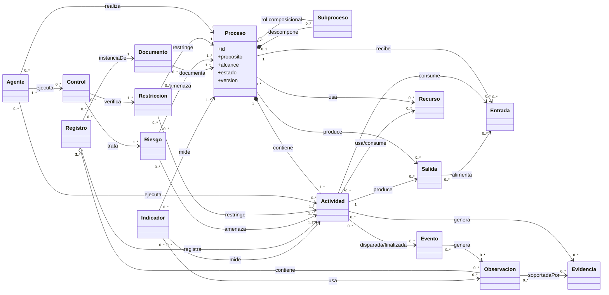

# Diagrama UML conceptual — MetaModelo Universal de Procesos

| Campo | Valor |
|---|---|
| Identificador | GOEI-PMM-UML-0001 |
| Versión | 0.1.0-draft |

Las multiplicidades representan el contrato conceptual, no el número de instancias operacionales de una ejecución concreta.
