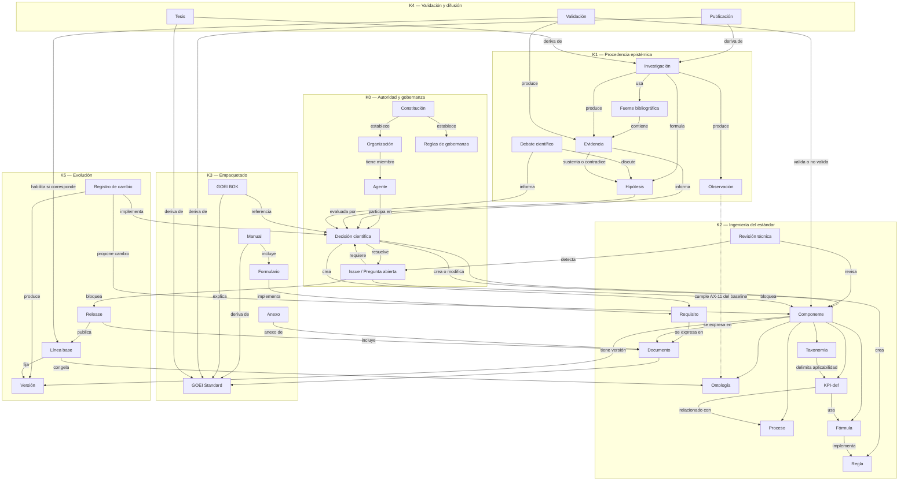

# Diagrama conceptual completo — GOEI Knowledge Graph

| Campo | Valor |
|---|---|
| Identificador | GOEI-KG-DGM-0001 |
| Versión | 0.1.0-draft |

## Lectura

Las flechas sólidas representan relaciones permitidas; no afirman que todas existan hoy. La línea punteada marca una restricción heredada del baseline D-006/D-006-REV. Ningún camino desde `Publicación`, `Tesis`, `Manual`, `Formulario` o `BOK` crea autoridad normativa en sentido inverso.
